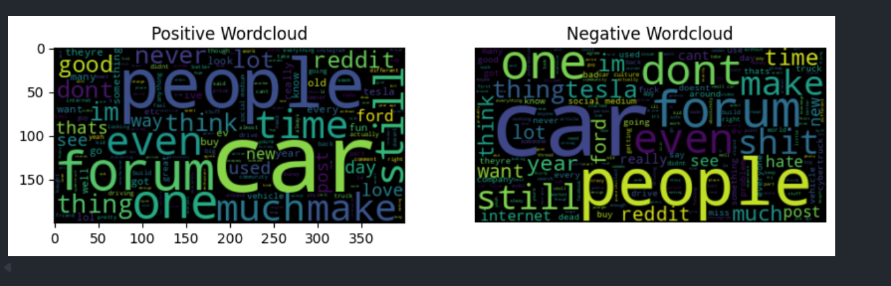
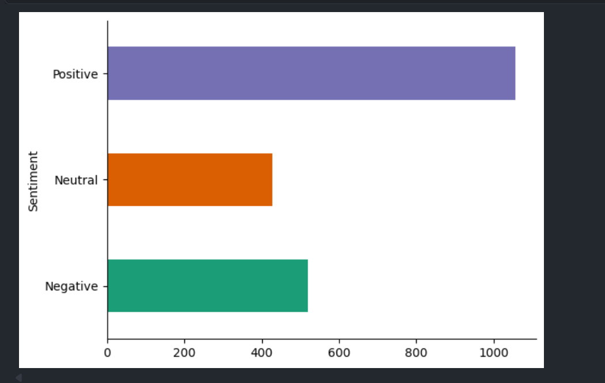
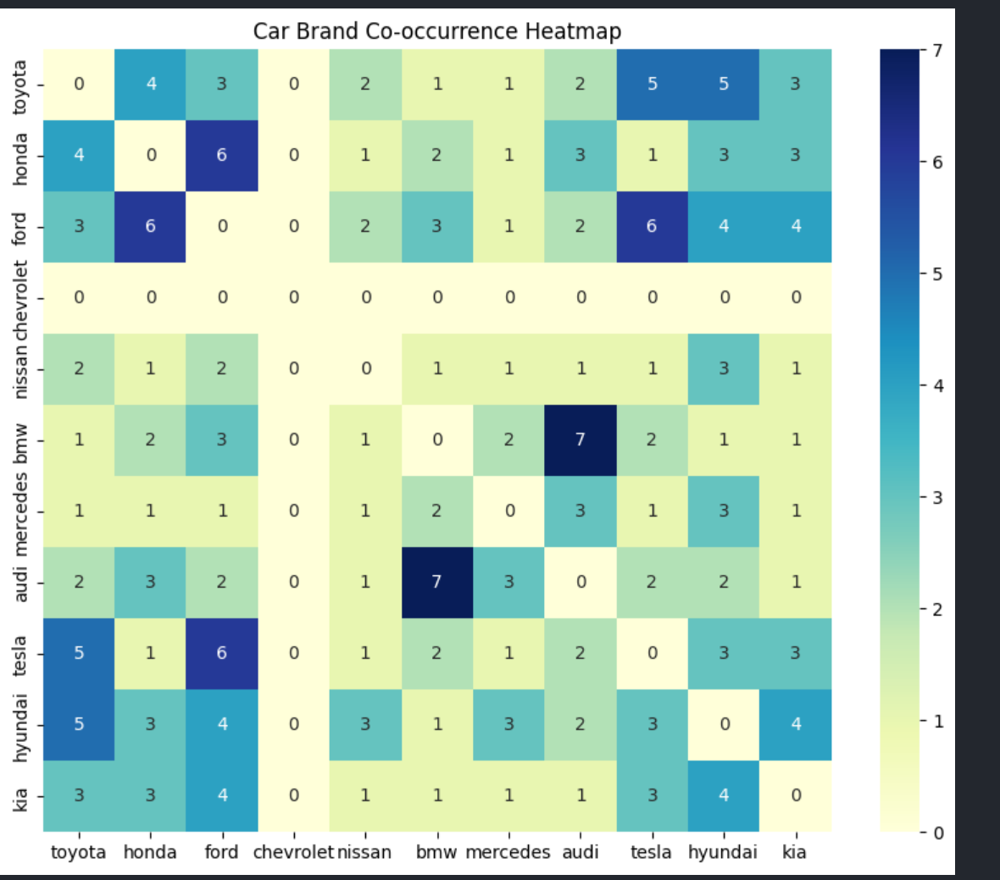
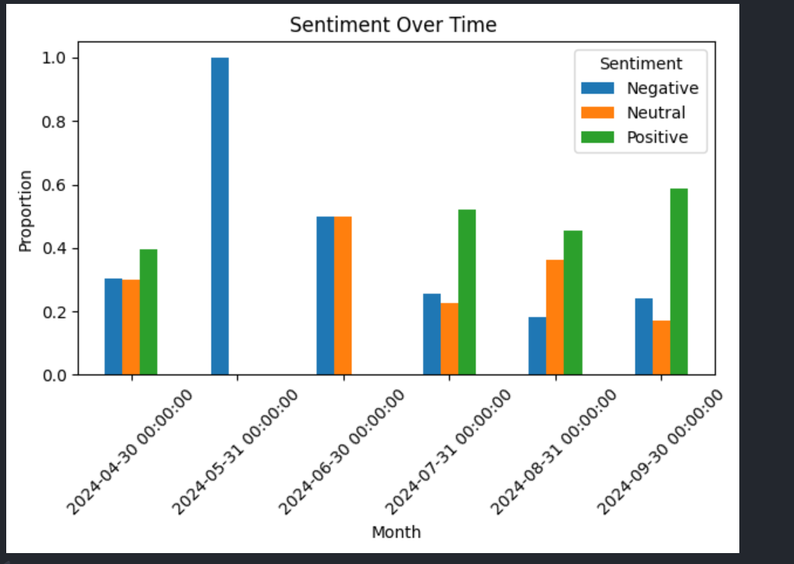

# TorqueLens — Automotive Sentiment & Topic Intelligence

> Mining Reddit's car communities to surface what drivers actually think — through NLP, sentiment analysis, and unsupervised topic modeling.

---

## What This Project Does

TorqueLens is an end-to-end NLP research pipeline that collects, cleans, and analyzes automotive discourse from Reddit. Starting from raw comment text scraped across five car-focused subreddits, it produces structured insights about consumer sentiment, brand perception, fuel-type trends, and latent discussion topics.

The result: interactive visualizations that answer questions like *"Are EV conversations trending more negative over time?"* or *"Which brands are most often discussed together?"*

---

## Highlights

- **2,000+ Reddit comments** collected across `/r/cars`, `/r/electricvehicles`, `/r/whatcarshouldIbuy`, and more
- **Full NLP preprocessing pipeline** — URL stripping, tokenization, stopword removal, lemmatization
- **Dual-method topic modeling** — LDA (Gensim) and NMF (scikit-learn TF-IDF) for cross-validated topic discovery
- **VADER sentiment analysis** with time-series decomposition of polarity trends
- **Feature extraction** for fuel types and an 11-brand co-occurrence heatmap
- **Full-stack scaffold** — Django REST backend + Next.js frontend ready for a dashboard layer

---

## Tech Stack

| Layer | Technology |
|---|---|
| Data Collection | PRAW (Reddit API) |
| Data Processing | Pandas, NumPy |
| NLP | NLTK — tokenization, lemmatization, VADER sentiment |
| Topic Modeling | Gensim LDA, scikit-learn NMF + TF-IDF |
| Visualization | Matplotlib, Seaborn, WordCloud |
| Backend | Django 5 |
| Frontend | Next.js 14 (App Router) |

---

## AI & NLP Pipeline

```
Raw Reddit Comments
       │
       ▼
  Preprocessing
  ├─ Remove URLs & special characters
  ├─ Lowercase normalization
  ├─ NLTK word tokenization
  ├─ Stopword filtering
  └─ WordNet lemmatization
       │
       ▼
  Feature Engineering
  ├─ VADER compound sentiment scores  →  Positive / Neutral / Negative
  ├─ Keyword extraction by sentiment class
  ├─ Fuel-type classification  (gas / diesel / electric / hybrid)
  └─ Car brand co-occurrence matrix  (11 brands × 11 brands)
       │
       ▼
  Topic Modeling
  ├─ LDA (Gensim)  — bag-of-words corpus, 5 latent topics, coherence scored
  └─ NMF (sklearn) — TF-IDF matrix, 10 topics, top-10 terms per topic
       │
       ▼
  Visualizations & Insights
```

---

## Snapshots

**Word Cloud — Positive vs Negative Sentiment**


**Sentiment Distribution Across Comments**


**Car Brand Co-occurrence Heatmap**


**Sentiment Proportions Over Time**


---

## Project Structure

```
TorqueLens/
├── Main-Research.ipynb        # Full analysis notebook
├── docs/
│   └── images/                # Exported visualizations
├── backend/                   # Django REST API scaffold
│   ├── manage.py
│   ├── requirements.txt
│   └── server/
│       ├── settings.py
│       ├── urls.py
│       └── wsgi.py / asgi.py
└── frontend/                  # Next.js dashboard scaffold
    ├── package.json
    ├── next.config.js
    └── app/
        ├── layout.js
        ├── page.js
        └── globals.css
```

---

## Quickstart

### Research Notebook

```bash
# 1. Open Main-Research.ipynb in Jupyter or Colab
# 2. Run the first cell to install dependencies
# 3. Set your Reddit API credentials in the API section:
APP_ID     = "your-app-id"
APP_SECRET = "your-app-secret"
# 4. Run all cells top to bottom
# 5. Figures are exported to docs/images/
```

> Get Reddit API credentials at [reddit.com/prefs/apps](https://www.reddit.com/prefs/apps). Never commit credentials — use environment variables or a `.env` file.

### Backend (Django)

```bash
python -m venv .venv
source .venv/bin/activate        # Windows: .venv\Scripts\activate
pip install -r backend/requirements.txt
python backend/manage.py migrate
python backend/manage.py runserver
```

### Frontend (Next.js)

```bash
cd frontend
npm install
npm run dev
```

---

## Roadmap

- [ ] Secure credential handling via `.env` + `python-decouple`
- [ ] Data caching and deduplication for reproducible runs
- [ ] Expand feature extraction — model years, price bands, reliability themes
- [ ] Improve LDA coherence with hyperparameter tuning (passes, alpha/eta)
- [ ] Connect Django API to serve analysis results to the Next.js dashboard
- [ ] Export pipeline to a scheduled job (scrape → analyze → publish)

---

## Skills Demonstrated

`NLP` `Sentiment Analysis` `Topic Modeling` `LDA` `NMF` `TF-IDF` `VADER`
`PRAW` `Pandas` `scikit-learn` `Gensim` `NLTK` `Seaborn` `Data Visualization`
`Django` `Next.js` `REST APIs` `Python` `Full-Stack`
